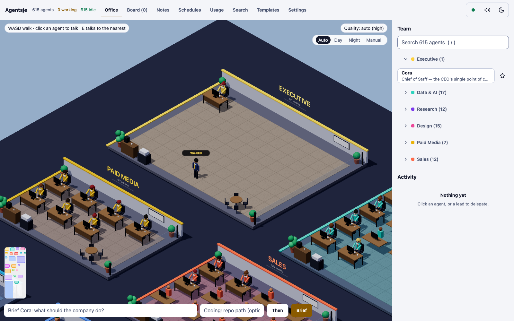

# agentsje

**An AI company you can walk through.**

agentsje is a game-style web app. You are the CEO of an open-plan office staffed by AI agents. You walk the floor
in a 3D office, brief one agent — the Chief of Staff — and she plans the work, delegates it across departments, and
writes one final answer back to you. Every agent is a real coding agent run headless on your own machine.

## Screenshots

The CEO stands on the Executive floor. Each department has its own zone of desks; the panel on the right lists the
team, and the bar at the bottom briefs the Chief of Staff.

## What's inside

- **The office** — a Three.js isometric floor with one desk per agent, live status above each head, day/night
  lighting, a minimap and click-to-walk pathfinding. Click a desk to see that agent's work.
- **The company** — 600+ agents in 23 departments (engineering, design, security, finance, marketing, research …),
  each defined by a Markdown file with a role and a set of skills. Department leads delegate inside their department.
- **Delegation** — the Chief splits a brief into sub-tasks for leads or specialists; children run in parallel, and
  when the last one finishes the parent writes the combined answer. Depth and fan-out are capped.
- **Coding tasks with a gate** — a task can be pointed at a git repository. The agent works in its own git worktree,
  can be made to plan first and wait for your approval, and hands back a reviewable diff.
- **Automation** — reusable task templates, multi-step chains, schedules, Slack/Discord/webhook notifications,
  per-agent memory notes, a daily budget and usage reports.
- **Evals** — prompt evals that check the Chief still delegates sensibly, runnable as a weekly gate.

## Architecture

See [`ARCHITECTURE.md`](./ARCHITECTURE.md).

## What this repository is

This is the **public** showcase of agentsje. The application code lives in a private repository. This repo holds
only the product description, the architecture overview, the version table and screenshots — no source code, keys,
tokens, internal URLs or personal data.
